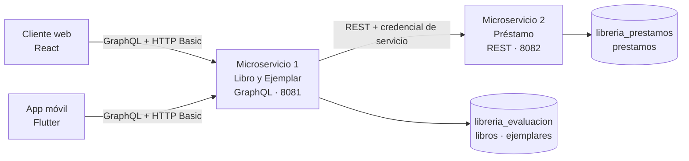
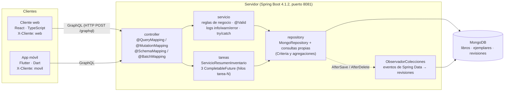
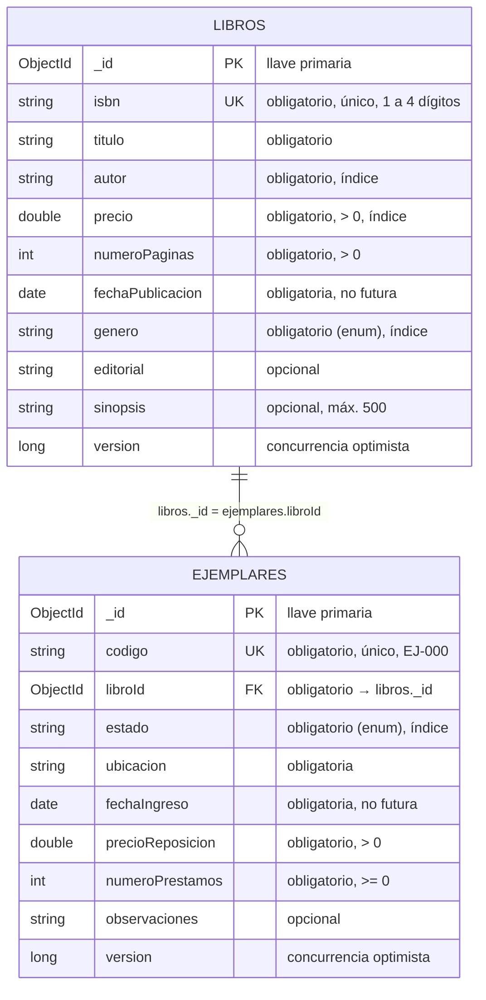
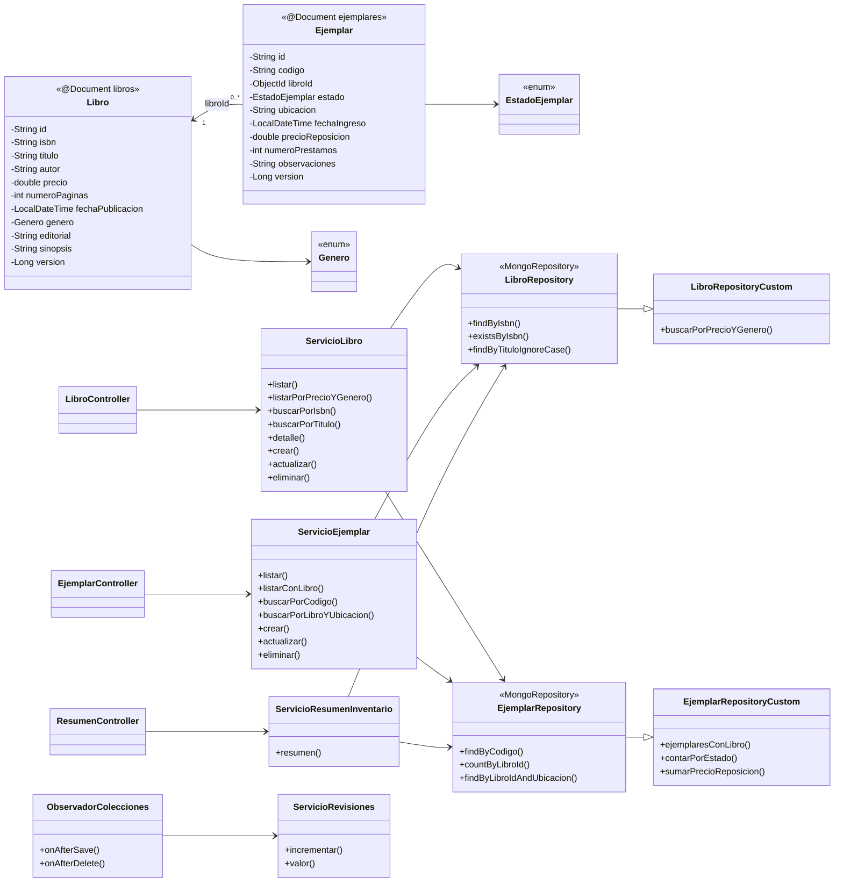

# Librería — Tercer Proyecto (Microservicios)

**Desarrollo de Aplicaciones Empresariales · Universidad de Ibagué · 2026B**
**Integrantes:** Misael Gallo Tangarife, Sara Zambrano, Santiago Guimel, Alejandra González · **Versión 3.0.0**

Proyecto final del curso. **Libro (A) → Ejemplar (B)** siguen en MongoDB detrás de GraphQL, y
se agrega la **clase C, Préstamo**, como un **segundo microservicio REST con su propia base de
datos**. Los clientes solo hablan con el microservicio GraphQL, que invoca al de préstamos de forma
transparente. El acceso se protege con un **login básico de Spring Security**.

| Proyecto | Tecnología | Carpeta |
|---|---|---|
| Microservicio 1: Libro y Ejemplar (GraphQL, puerto 8081) | Java 17 · Spring Boot 4.1.2 · Spring for GraphQL · Spring Security · Spring Data MongoDB · Lombok · Bean Validation | [`servidor-libreria-mongo/`](servidor-libreria-mongo) |
| Microservicio 2: Préstamo (REST, puerto 8082) | Java 17 · Spring Boot 4.1.2 · Spring Web · Spring Security · Spring Data MongoDB | [`servicio-prestamos-rest/`](servicio-prestamos-rest) |
| Cliente web | TypeScript · React 18 · Vite | [`cliente-web-react/`](cliente-web-react) |
| App móvil | Dart · Flutter (Android) | [`cliente-movil-flutter/`](cliente-movil-flutter) |
| Bases de datos | MongoDB 8 (no relacional) | `libreria_evaluacion` (libros, ejemplares) y `libreria_prestamos` (prestamos) |

**Login de demostración:** usuario `profesor`, contraseña `libreria`. Se cambian con las variables
de entorno `LIBRERIA_USUARIO` y `LIBRERIA_CLAVE`.

---

## Microservicios



- **Transparencia:** los clientes usan `prestamos`, `crearPrestamo`, etc. en GraphQL y no conocen la
  URL del servicio REST (`integracion/ClientePrestamos` usa `RestClient`).
- **Integridad referencial:** no se crea un préstamo si el ejemplar no existe, y no se elimina un
  ejemplar con préstamos. Si el servicio de préstamos no responde, el ejemplar tampoco se elimina.
- **Uno a uno por consulta:** por cada préstamo, `ServicioPrestamo` busca su ejemplar y luego su libro
  para completar `tituloLibro` y `autorLibro` (dos atributos de la clase A).
- **Reglas de Préstamo:** código único `PR-000`, un solo préstamo activo por ejemplar (índice parcial
  único), fecha no futura, días entre 1 y 365, multa no negativa y concurrencia con `@Version`.

| Método | Ruta REST | Para qué |
|---|---|---|
| GET | `/prestamos/healthCheck` | Estado del servicio (público) |
| GET | `/prestamos?pagina&tamanio&codigoEjemplar&estado` | Listar con filtros |
| GET | `/prestamos/{codigo}` | Consultar uno |
| GET | `/prestamos/ejemplar/{codigoEjemplar}/cantidad` | Contar préstamos de un ejemplar |
| POST | `/prestamos` | Insertar (201) |
| PUT | `/prestamos/{codigo}` | Actualizar |
| DELETE | `/prestamos/{codigo}` | Eliminar |

## Arquitectura del microservicio GraphQL



- **GUI** (dos clientes en lenguaje distinto al servidor): una pantalla por caso de uso y menú
  principal con **Ayuda → Acerca de...** (integrantes y versión 3.0.0).
- **Modelo y clases estructurales en sus paquetes** (servidor `com.libreria.servidor`):

  | Paquete | Contenido |
  |---|---|
  | `model` | Documentos `Libro` y `Ejemplar` (`@Document`, `@Id`, `@Indexed`, `@Version`, Lombok `@Builder`), enums y tipos de respuesta (`Pagina`, `EjemplarConLibro`, `DetalleLibro`, `ResumenInventario`…) |
  | `dto` | `LibroInput`, `EjemplarInput`, `PrestamoInput` (un solo input para crear y actualizar) y la validación propia `@IsbnValido` |
  | `repository` | `LibroRepository`, `EjemplarRepository` (`MongoRepository`) y sus implementaciones de consultas propias |
  | `integracion` | `ClientePrestamos`: invoca el microservicio REST y traduce sus errores |
  | `servicio` | `ServicioLibro`, `ServicioEjemplar`, `ServicioPrestamo` (fachada de C), `ServicioRevisiones`, `ObservadorColecciones`, `GeneradorDatosCarga` |
  | `controller` | `LibroController`, `EjemplarController`, `PrestamoController`, `ResumenController` (GraphQL) y `SesionController` (login) |
  | `config` | `MongoConfig` (`AbstractMongoClientConfiguration`), `SeguridadConfig` (Spring Security), `EjecutorTareasConfig`, escalar `LocalDateTime`, `RegistroOperaciones` (X-Cliente), `DatosIniciales` |
  | `excepciones` | `LibreriaException` (con tipo) y `ManejadorErrores` (errores GraphQL en español) |
  | `tareas` | `ServicioResumenInventario` (3 tareas concurrentes) |

## Modelo no relacional (MongoDB)



| Colección | Índices |
|---|---|
| `libros` | `_id`, **`isbn` (único)**, `autor`, `precio`, `genero`, compuesto `genero_precio` (genero, precio) |
| `ejemplares` | `_id`, **`codigo` (único)**, `libroId`, `estado`, compuesto `libro_ubicacion` (libroId, ubicacion) |
| `revisiones` | `_id` = nombre de la colección; `valor` aumenta con `$inc` en cada cambio (Observer entre clientes) |

Ejemplo real de un documento de `ejemplares` (la llave foránea es un `ObjectId`, no texto):

```json
{ "_id": {"$oid": "6af377e075da53cd0c59caab"}, "codigo": "EJ-001",
  "libroId": {"$oid": "6af377e075da53cd0c59ca9f"}, "estado": "PRESTADO", "ubicacion": "Estante A1",
  "fechaIngreso": {"$date": "2024-02-10T14:00:00Z"}, "precioReposicion": 65000.0,
  "numeroPrestamos": 5, "version": 1 }
```

Los clientes nunca manejan el `ObjectId`: envían y reciben el **ISBN** del libro y el servidor lo
traduce a `libroId` (`Ejemplar.libro` e `Ejemplar.isbnLibro` se resuelven con `@BatchMapping`, en una
sola consulta por respuesta).

## Diagrama de clases (servidor)



## Operaciones GraphQL

| Tipo | Operación | Para qué |
|---|---|---|
| Query | `libros(pagina, tamanio)` | Listar todos (paginado) |
| Query | `librosPorPrecioYGenero(precioMin, precioMax, genero, pagina, tamanio)` | **Consulta propia**: listar por filtro (Criteria en MongoDB) |
| Query | `libroPorIsbn(isbn)` · `libroPorTitulo(titulo)` | Consultar UN libro (dos criterios; el título sin mayúsculas ni tildes, con *collation*) |
| Query | `detalleLibro(isbn)` | **Consulta propia maestro + detalle**: libro, sus ejemplares y conteos por estado |
| Query | `ejemplares(pagina, tamanio)` | Listar todos los ejemplares (paginado) |
| Query | `ejemplaresConLibro(estado, isbn, pagina, tamanio)` | **Consulta propia** (`$lookup`): todos los atributos del ejemplar + isbn, título y autor del libro |
| Query | `ejemplarPorCodigo(codigo)` · `ejemplaresPorLibroYUbicacion(isbn, ubicacion)` | Consultar ejemplar (dos criterios) |
| Query | `revisionLibros` · `revisionEjemplares` | Observer entre clientes (contador en la colección `revisiones`) |
| Query | `resumenInventario` | Resumen calculado por las 3 tareas concurrentes |
| Mutation | `crearLibro` · `actualizarLibro(input: LibroInput)` · `eliminarLibro(isbn)` | CRUD de Libro (un solo input; el isbn indica cuál se actualiza) |
| Mutation | `crearEjemplar` · `actualizarEjemplar(input: EjemplarInput)` · `eliminarEjemplar(codigo)` | CRUD de Ejemplar (un solo input; el código indica cuál se actualiza) |
| Query | `prestamos(pagina, tamanio, codigoEjemplar, estado)` | Listar préstamos con filtro y dos atributos de Libro |
| Query | `prestamoPorCodigo(codigo)` | Consultar UN préstamo |
| Mutation | `crearPrestamo` · `actualizarPrestamo(input: PrestamoInput)` · `eliminarPrestamo(codigo)` | CRUD de Préstamo (invoca el microservicio REST) |
| Mutation | `generarDatosCarga(libros, ejemplares)` | Solo desarrollo (perfil `carga`): 1.000 libros y 5.000 ejemplares |

La consola GraphiQL queda en <http://localhost:8081/graphiql> y pide el mismo usuario y contraseña.

## Reglas de negocio (en el servidor, nunca en la GUI)

- ISBN y código únicos (índices únicos de MongoDB).
- No se elimina un libro que tiene ejemplares.
- Un ejemplar solo se crea para un libro existente y no cambia de libro.
- No se elimina un ejemplar que tiene préstamos; un préstamo no cambia de código ni de ejemplar.
- `numeroPrestamos` suma 1 cuando el ejemplar **pasa** a PRESTADO; en Actualizar el valor que envía el cliente se ignora.
- Validaciones con Bean Validation (`@Valid`) y mensajes en español: obligatorios, positivos (`@Positive`, `@PositiveOrZero`), fechas no futuras (`@PastOrPresent`), ISBN de 1 a 4 dígitos (`@IsbnValido`) y código EJ-000 (`@Pattern`), largos máximos de los opcionales.

## Concurrencia y cantidad de datos

- **Altas simultáneas** del mismo ISBN/código: el índice único deja guardar solo una; la
  `DuplicateKeyException` se registra con `logger.warn` y responde "Ya existe…".
- **`@Version`** (concurrencia optimista): el cliente envía la versión que leyó; si otro usuario
  cambió el documento, MongoDB no lo guarda (`OptimisticLockingFailureException`) → `logger.warn` y
  "Otro usuario modificó este libro; vuelva a buscarlo".
- **Observer entre clientes**: `ObservadorColecciones` escucha los eventos de Spring Data
  (`AfterSaveEvent`, `AfterDeleteEvent`) y aumenta con `$inc` la revisión de la colección en MongoDB;
  los clientes la consultan cada 15 s y refrescan su grilla.
- **Servicio con 3 tareas** (`tareas/ServicioResumenInventario`): contar libros, contar ejemplares
  por estado (agregación) y valor total del inventario, en paralelo con `CompletableFuture` sobre el
  ejecutor propio `ejecutorTareas` (hilos `tarea-1..3`), unidas con `allOf`, con tiempo máximo
  (`orTimeout`) y `exceptionally` + `logger.error` si una falla (las otras dos igual se entregan).
- **Paginación en todos los Listar** (skip/limit en MongoDB) y filtros siempre en MongoDB. El
  `$lookup` se hace después de paginar: solo une los ejemplares de la página pedida.
- **Datos iniciales**: la base `libreria_evaluacion` empieza vacía. Los libros y ejemplares se crean
  desde los clientes y se conservan entre reinicios. La carga de ejemplos requiere `libreria.datos-iniciales.habilitado=true`; el perfil
  `carga` usa su propia base `libreria_carga` con 1.000 libros y 5.000 ejemplares.

## Logging

`logback-spring.xml`: consola con hora, nivel, hilo y clase + archivo rotativo `logs/servidor.log`.
Cada servicio y controller tiene su `Logger` (SLF4J): **info** = operación recibida y resultado;
**warn** = rechazo de negocio (no existe, duplicado, validación, conflicto de versión); **error** =
excepción inesperada en el `catch` (con la excepción). Además `RegistroOperaciones` escribe una
línea por operación con el cliente que la hizo (encabezado `X-Cliente`). Ejemplos reales:

```
15:00:32.883 INFO  [tarea-2] c.l.s.t.ServicioResumenInventario - Tarea contar-ejemplares-por-estado iniciada en el hilo tarea-2
15:00:44.935 WARN  [http-nio-8081-exec-5] c.l.servidor.servicio.ServicioLibro - Crear libro rechazado: Ya existe un libro con el ISBN 1001.
15:06:23.820 ERROR [tarea-2] c.l.s.t.ServicioResumenInventario - Tarea contar-libros falló: DataAccessResourceFailureException: MongoDB no responde
15:00:44  App móvil    | consulta ejemplaresConLibro
```

## Cómo correr todo

**Requisitos:** MongoDB 8 en `localhost:27017`, JDK 17 (`JAVA_HOME`), Node 22, Flutter 3.41 y,
para el celular, Android platform-tools (`adb`).

**Todo de una vez (Windows):** doble clic en `iniciar-demo.cmd`. Comprueba que MongoDB esté arriba
(si no, lo inicia: primero el servicio de Windows y, si pide administrador, como proceso del
usuario), levanta los dos microservicios, el cliente web y, si hay un celular conectado por USB,
instala y abre la app (`adb reverse tcp:8081 tcp:8081`). Si el código cambió, recompila antes.

**Por partes:**

```bash
# 1. Microservicio REST de Préstamo (base libreria_prestamos)
cd servicio-prestamos-rest
./mvnw spring-boot:run                                   # http://localhost:8082/prestamos

# 2. Microservicio GraphQL de Libro y Ejemplar (base libreria_evaluacion)
cd servidor-libreria-mongo
./mvnw spring-boot:run                                   # http://localhost:8081/graphql
./mvnw spring-boot:run -Dspring-boot.run.profiles=carga  # base libreria_carga con 1.000 + 5.000

# 3. Cliente web
cd cliente-web-react && npm install && npm run dev      # http://localhost:5173

# 4. App (celular por USB)
adb reverse tcp:8081 tcp:8081
cd cliente-movil-flutter && flutter run --dart-define=URL_GRAPHQL=http://localhost:8081/graphql
```

| Variable | Para qué | Valor por defecto |
|---|---|---|
| `LIBRERIA_USUARIO` / `LIBRERIA_CLAVE` | Login de los clientes | `profesor` / `libreria` |
| `PRESTAMOS_URL` | Dónde está el microservicio REST | `http://localhost:8082` |
| `PRESTAMOS_USUARIO` / `PRESTAMOS_CLAVE` | Credencial entre microservicios (igual en ambos) | `servicio-libreria` / `prestamos-local` |
| `PRESTAMOS_MONGO_URI` / `PRESTAMOS_MONGO_BASE` | MongoDB del microservicio REST | `mongodb://localhost:27017` / `libreria_prestamos` |
| `LIBRERIA_MONGO_URI` / `LIBRERIA_MONGO_BASE` | MongoDB del microservicio GraphQL | `mongodb://localhost:27017` / `libreria_evaluacion` |

**Probar las APIs con Bruno:** abre la colección [`bruno-libreria/`](bruno-libreria) y elige el
entorno **Demo**. Tiene login, GraphQL de Préstamo, Libro y Ejemplar, y el REST de Préstamo. El
lanzador la agrega a Bruno y lo abre. Las peticiones de Insertar usan `codigoEjemplar` del entorno,
que debe ser un ejemplar existente.

**Consultar las colecciones con `mongosh`:**

```js
use libreria_evaluacion
show collections                                  // libros, ejemplares, revisiones
db.ejemplares.getIndexes()
db.ejemplares.findOne({ codigo: "EJ-001" })       // libroId: ObjectId("…")
db.ejemplares.aggregate([{ $lookup: { from: "libros", localField: "libroId", foreignField: "_id", as: "libro" } },
                         { $match: { libro: { $size: 0 } } }, { $count: "huerfanos" }])   // sin resultados
```

## Pruebas

| Proyecto | Comando | Resultado |
|---|---|---|
| Microservicio GraphQL, servicios | `./mvnw test` (JUnit 5 + Mockito, sin MongoDB) | **187 pruebas**, **100 % de líneas y ramas** en `servicio` y `tareas` (JaCoCo) |
| Microservicio GraphQL, integración | `./mvnw verify` (base `libreria_test`) | **78 pruebas**: GraphQL, login, HTTP/CORS, MongoDB, concurrencia, 3 tareas y carga |
| Microservicio REST, servicios | `./mvnw test` (JUnit 5 + Mockito, sin MongoDB) | **33 pruebas**, **100 % de líneas y ramas** en `servicio` (JaCoCo) |
| Web | `npm run lint`, `npm test`, `npm run build` | **84 pruebas** unitarias (Vitest) |
| Web E2E | `npm run e2e` (Playwright con los dos microservicios y MongoDB) | **38 pruebas**: login y todos los casos de uso en escritorio y celular, con capturas |
| App | `flutter analyze`, `flutter test` | **55 pruebas** + integración contra los microservicios reales |

El reporte de cobertura queda en `target/site/jacoco/index.html` de cada microservicio.

**Concurrencia:** 20 altas simultáneas del mismo ISBN → exactamente 1 éxito y 19 "Ya existe";
2 actualizaciones con la misma versión → 1 éxito y 1 conflicto; 2 préstamos simultáneos del mismo
ejemplar → 1 conflicto y el contador queda bien (+1).

**Carga** (1.000 libros y 5.000 ejemplares, promedio de 5 ejecuciones, `CargaTest`):

| Consulta | ms |
|---|---|
| Generar 1.000 libros + 5.000 ejemplares (insertMany) | 415 |
| Listar libros, página 1 de 50 (20 por página) | 7 |
| Listar libros, página 50 de 50 | 7 |
| Libros por precio 50.000–100.000 y FICCION | 6 |
| `ejemplaresConLibro` página 1 | 6 |
| `ejemplaresConLibro` página 250 de 250 | 9 |
| `ejemplaresConLibro` filtro PRESTADO | 6 |
| `resumenInventario` (3 tareas) | 6 |

## Patrones de diseño

| Patrón | Dónde |
|---|---|
| MVC | Servidor: `model` / `servicio` / `controller`; clientes: modelos, servicios GraphQL, pantallas |
| Builder | `Libro.builder()` y `Ejemplar.builder()` (Lombok `@Builder`), usados en los servicios, la semilla y el generador |
| Observer | Servidor: `ObservadorColecciones` (eventos de Spring Data) → revisiones; web: `observer/Observable.ts`; app: `observador/listado_observable.dart` |
| Singleton | `ClienteGraphQL` en la web (`getInstancia()`) y en la app (constructor de fábrica) |
